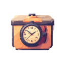

<p align="center"></p>

<h1 align="center">WatchBox for desktop</h1>

<p align="center">Movies and TV on Windows, macOS and Linux, with an mpv player that plays everything.</p>

This repository holds **installers only**. Get them from
**[Releases → Latest](https://github.com/Nicartjay/Watchbox-Desktop-Releases/releases/latest)**.

| System | Download |
|---|---|
| Windows 10/11, x64 | `watchbox-<version>-windows-x64-setup.exe` |
| Windows 11 on ARM | `watchbox-<version>-windows-arm64-setup.exe` |
| macOS 11+, Apple Silicon | `watchbox-<version>-macos-arm64.dmg` |
| macOS 11+, Intel (or any Mac) | `watchbox-<version>-macos-universal.dmg` |
| Linux, any distro | `watchbox-<version>-linux-x86_64.AppImage` / `-linux-aarch64.AppImage` |
| Ubuntu 24.04+, Debian 13+ | `watchbox-<version>-linux-x86_64.deb` / `-linux-aarch64.deb` |

## Installing

**Windows.** Run the setup. The installer is not code-signed, so SmartScreen may say "Windows
protected your PC". Choose **More info → Run anyway**. On Windows on ARM, if WatchBox reports
that OpenGL is missing, install Microsoft's
[OpenCL, OpenGL, and Vulkan Compatibility Pack](https://apps.microsoft.com/detail/9nqpsl29bfff)
and start it again.

**macOS.** Open the DMG and drag WatchBox into Applications. The app is not notarised, so the
first launch is blocked:
- **macOS 15 and later:** open WatchBox once, dismiss the warning, then go to
  **System Settings → Privacy & Security**. Scroll down, click **Open Anyway** and confirm.
- **macOS 14 and earlier:** right-click WatchBox in Applications, choose **Open**, then
  **Open** again.
- **If macOS says the app "is damaged":** run
  `xattr -dr com.apple.quarantine /Applications/WatchBox.app` in Terminal.

**Linux.** AppImage: `chmod +x watchbox-*.AppImage`, then run it. Debian/Ubuntu:
`sudo apt install ./watchbox-*.deb`, which also installs `libmpv2`.

## Updates

WatchBox checks this page at launch and once a day; turn that off under **Settings → Updates**.
Before anything is installed, the app checks two things:
- The minisign signature on `SHA256SUMS.txt`, against a public key built into the app.
- The installer's SHA-256 against its line in that file.

To check a download by hand:

```sh
minisign -Vm SHA256SUMS.txt -P RWQzQn7cEB8MZrpRuSNi5fyLgPGWtByxrdptKvZN+WFyRh+Z6lqm3RSt
sha256sum --check --ignore-missing SHA256SUMS.txt     # macOS: shasum -a 256 -c
```

## Disclaimer

WatchBox is a client interface. It does not host, store or distribute any content. The
built-in source reads third-party sites, and WatchBox is not affiliated with them. You are
responsible for how you use the app and for complying with the law and copyright where you
live.

## Licence and notices

WatchBox is free software under the [GNU GPL-3.0](LICENSE). Its source code is available on
request from the author.

It is built with and distributes:
- **[mpv](https://mpv.io)** with **[FFmpeg](https://ffmpeg.org)**, libass and their libraries.
  - On Windows and Linux these are GPL builds.
  - On macOS they come from [media-kit](https://github.com/media-kit/libmpv-darwin-build).
  - Each is under its own licence (GPL-2.0-or-later / LGPL-2.1-or-later). Source is at the
    linked projects.
- **Rentaro**, a source extension (Apache-2.0), with its catalogue and stream logic ported to
  Rust.
- The design system of **[NuvioMobile](https://github.com/NuvioMedia/NuvioMobile)**
  (GPL-3.0), by way of WatchBox for Android.
- **[egui/eframe](https://github.com/emilk/egui)** and the other Rust crates it uses, under
  MIT, Apache-2.0 or BSD-style licences.
- **JetBrains Sans** (Apache-2.0) and **[Phosphor Icons](https://phosphoricons.com)** (MIT).

Metadata and images come from [TMDB](https://www.themoviedb.org). This product uses the TMDB API
but is not endorsed or certified by TMDB.
